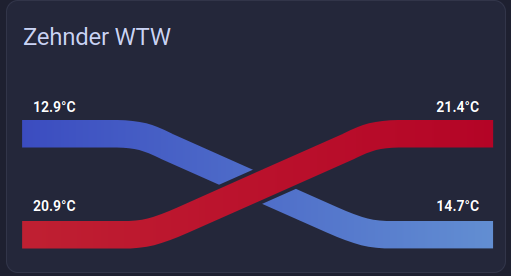

# HRV Card — Heat Recovery Ventilation for Home Assistant

[](https://my.home-assistant.io/redirect/hacs_repository/?owner=CodedCactus&repository=hrv-card&category=plugin)

[](https://github.com/CodedCactus/hrv-card/actions/workflows/build.yml)


[](https://github.com/CodedCactus/hrv-card/releases)

**HRV Card** is a custom [Home Assistant](https://www.home-assistant.io/) Lovelace card for visualizing Heat Recovery Ventilation (HRV) and Energy Recovery Ventilation (ERV) systems. It turns outdoor, supply, extract, and exhaust temperature sensors into a live, animated airflow diagram with dynamic cold-to-warm gradients and optional status sensors.

Works with any Home Assistant HRV/ERV integration that exposes temperature entities, including Zehnder, Mitsubishi, Panasonic, and ESPHome-based systems.

## Features

* 🌡️ **Real-time HRV temperature visualization** - Displays outdoor, supply, extract, and exhaust temperatures on one card
* 🎨 **Dynamic color gradients** - Cold-to-warm flow mapping with smooth color transitions
* 🏠 **Native Home Assistant integration** - Inherits your active theme, colors, and typography
* 📱 **Responsive SVG visualization** - Scales cleanly on desktop, tablet, and mobile dashboards
* 📐 **Dashboard-aware sizing** - Works with Home Assistant masonry and Sections view layout APIs
* 🛠️ **Visual card editor** - Configure temperature entities, animation, and extra sensors without YAML
* ⚡ **Lightweight and fast** - Built with Lit and a canvas particle renderer
* ♿ **Accessibility-aware** - Animation respects reduced-motion settings and pauses when offscreen or hidden
* 🔧 **Customizable sensor display** - Add bypass, heater, flow, filter, or any other status sensor

## Preview

<picture>
  <source srcset="docs/preview.webp" type="image/webp">
  
</picture>

## Installation

### 🟡 HACS (Recommended)

1. Open **HACS → Frontend**
2. Click **⋮ → Custom repositories**
3. Add this repository: `https://github.com/CodedCactus/hrv-card`
4. Select category: **Lovelace**
5. Install **HRV Card**
6. Restart Home Assistant

Or use the **Open in HACS** badge above to jump straight to the repository in your Home Assistant instance.

### 🔧 Manual Installation

1. Download `hrv-card.js` from the [latest release](https://github.com/CodedCactus/hrv-card/releases)
2. Copy it to your Home Assistant `www` directory:

   ```text
   /config/www/hrv-card.js
   ```

3. Add the resource to your Home Assistant configuration:

   ```yaml
   resources:
     - url: /local/hrv-card.js
       type: module
   ```

4. Restart Home Assistant

## Usage

### Add via UI Editor

1. Go to your dashboard in edit mode
2. Click **Add Card**
3. Search for **HRV Card**
4. Pick your four HRV temperature entities
5. Add optional status sensors such as bypass, heater, flow, or filter

### YAML Configuration

```yaml
type: custom:hrv-card
title: HRV System
outdoor_temp: sensor.outdoor_temperature
supply_temp: sensor.hrv_supply_temperature
extract_temp: sensor.hrv_extract_temperature
exhaust_temp: sensor.hrv_exhaust_temperature
sensors:
  - entity: binary_sensor.hrv_bypass
    label: Bypass
  - entity: binary_sensor.hrv_pre_heater_status
    label: Heater
  - entity: sensor.hrv_exhaust_flow_rate
    label: Flow
    unit: m³/h
  - entity: sensor.hrv_exhaust_fan_duty_cycle
    label: Duty
    unit: "%"
```

## Configuration Options

| Option | Required | Type | Description |
|--------|----------|------|-------------|
| `title` | No | string | Card title (defaults to "HRV System") |
| `outdoor_temp` | Yes | string | Entity ID for outdoor temperature |
| `supply_temp` | Yes | string | Entity ID for supply air temperature |
| `extract_temp` | Yes | string | Entity ID for extract air temperature |
| `exhaust_temp` | Yes | string | Entity ID for exhaust air temperature |
| `sensors` | No | array | Additional status sensors shown below the diagram |
| `animation` | No | boolean | Enable flow animation (default: `true`; disabled when reduced motion is requested) |

### Sensor Configuration

Each entry in `sensors` supports:

| Option | Required | Type | Description |
|--------|----------|------|-------------|
| `entity` | Yes | string | Entity ID of the sensor |
| `label` | No | string | Display label (defaults to the entity name) |
| `format` | No | string | Display format: `"binary"`, `"text"`, or `"number"` (auto-detected) |
| `decimals` | No | number | Decimal places for numeric sensors (default: 1) |
| `unit` | No | string | Unit to display (auto-detected from the entity) |

## Compatibility

- Any Home Assistant integration exposing numeric temperature entities
- Celsius and Fahrenheit, using the entity unit or Home Assistant's configured temperature unit
- Light and dark themes
- Masonry dashboards and the newer Sections view
- `prefers-reduced-motion` for users who disable animations

## Development

### Prerequisites

- Node.js 22.22.2+ or 24.15+ (required by Vite 8 and jsdom 30)
- npm

> TypeScript 7 is used for `tsc`. The `typescript` package is aliased to TypeScript 6 for `typescript-eslint`, which does not yet expose the TypeScript 7 compiler API.

### Setup

```bash
# Clone the repository
git clone https://github.com/CodedCactus/hrv-card.git
cd hrv-card

# Install dependencies
npm ci
```

### Development Commands

```bash
# Start development server
npm run dev

# Build for production
npm run build

# Build and watch for changes
npm run build:watch

# Preview production build
npm run preview

# Type checking
npm run typecheck

# Linting
npm run lint

# Run tests
npm run test
```

## License

This project is licensed under the MIT License — see the [LICENSE](LICENSE) file for details.
